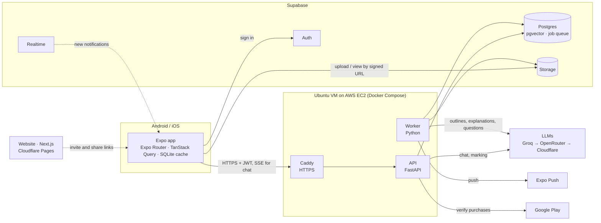

# Quizzly

AI study companion for university students, starting in Nigeria. A student uploads lecture notes or slides (PDF, PPTX or photos). Quizzly turns them into an outline of topics, explains each topic with page citations, writes exam-style practice questions, and answers questions about the notes. Coursemates can share a course so others study it without uploading.

It runs on open-source models through free hosted tiers, with a retrieval-augmented generation (RAG) pipeline built to stay close to $0 a month during the beta.

## Status

**v0.2, getting ready for beta.** 42 of the 46 tasks in the [build plan](docs/BUILD_PLAN.md) are done. Staging deploys on every merge to `main`.

| Area | What works |
|---|---|
| Sign-in and profile | Email code and Google sign-in, 4-step profile setup with photo, country and school |
| Notes | Courses with exam dates, PDF / PPTX / photo uploads, OCR for scans, offline course downloads |
| Study | Topic outlines (rename, merge, split), explanations in 3 styles with page citations, original page viewer |
| Practice | Quizzes in practice and exam mode, written-answer marking, flashcards, past-paper style, results with weak topics |
| Chat | Streaming answers from one document, cited, with a "Not in your notes" callout |
| Habits | Today plan, Daily 5, study days, celebrations, weekly recap image, themes, reminders |
| Social | Course sharing by link or Quizzly code, members, blocking, reports, invite links and credits |
| Notifications | In-app inbox in real time, push notifications, quiet hours |
| Plans | Free, Student and Premium limits, monthly AI allowance, Google Play purchase verification on the server |

**Still to do:**
- Website link routes and iPhone waitlist (D6).
- Play Billing checkout in the app (D10).
- Play Store listing and policy pages (E3).
- The admin app (E4).

## Architecture



- **The app reads, the API writes.** The app reads its own rows straight from Supabase. Every insert, update and delete goes through the API, which checks ownership (FRD §2.16).
- **Slow work runs in the worker.** Processing an upload, writing explanations and questions, marking, reminders and push all run as rows in a Postgres job queue (`FOR UPDATE SKIP LOCKED`). There's no Redis or paid queue.
- **One LLM gateway with fallback.** Requests try Groq, then OpenRouter's free models, then Cloudflare Workers AI. Models are chosen per task and plan in `services/api/config/models.yaml`. A daily AI budget pauses new AI work when it's reached.
- **Embeddings and OCR run on the VM's CPU.** `bge-small-en-v1.5` (fastembed) and Tesseract cost nothing per call.

### How notes become study material

1. The app asks the API for an upload, gets a signed URL, and uploads the file straight to Storage. The server chooses the storage path.
2. The worker extracts text (`pypdfium2`, `python-pptx`, Tesseract for scans and photos), splits it into chunks and embeds them into pgvector.
3. The worker builds an outline of topics with their page ranges. Identical files are shared by checksum, so a re-upload is processed only once.
4. When a student opens a topic or builds a quiz, the worker retrieves that topic's chunks and asks the LLM for an explanation or questions, each citing the pages it came from. Results are cached, so a repeat costs nothing.
5. Chat streams over Server-Sent Events. Each answer uses hybrid search (vector + keyword) over the document's chunks and cites pages, or marks the parts that aren't in the notes.

### Security rules

- The server generates every storage path (`uploads/{user_id}/{document_id}/…`).
- Shared-course members never receive storage URLs or other people's scores, chats or progress.
- Exam-mode quizzes contain no answers until submitted.
- Session tokens live in `expo-secure-store`.
- Limits, rate limits and paused accounts are enforced by the API, not the app.
- The interactive API docs are off in production.

## Repository layout

```
apps/mobile/          Expo app (Android first, iOS ready)
apps/web/             Next.js website: landing page now; invite links and admin to come
services/api/         FastAPI API and worker (app/api routes, app/domain queries, app/worker jobs,
                      app/rag pipeline, app/llm gateway), model routing in config/, tests in tests/ and e2e/
supabase/migrations/  Numbered SQL migrations: schema, row-level security, functions
evals/                Quality checks for outlines, questions and flashcards against real notes
infra/                Docker Compose, deploy script with rollback, Caddy, smoke tests
.github/workflows/    CI, deploys to staging and production, rollback
docs/                 Product, design and technical docs; API spec in docs/api/
```

## Environments and releases

| Environment | API | App | Deploys |
|---|---|---|---|
| Local | `uvicorn` on your PC | **Quizzly Dev** (dev client) or Expo Go | By hand |
| Staging | `staging-api` on the VM | **Quizzly Staging** (`eas build --profile preview`) | Every merge to `main` |
| Production | `api` on the VM | **Quizzly** (`app.quizzly`) | A `v*` release tag, after approval |

- Deploys use one Docker image per commit, check `/readyz` and the worker, and roll back automatically on failure. App changes that don't add native code ship as EAS Updates; a native change starts a new build.
- **Beta mode:** setting `BETA_PLAN=premium` in an environment's `.env` gives every account there Premium for free. Production refuses to start with it set.
- Details: [docs/CI_CD.md](docs/CI_CD.md).

## Getting started

You need Node 22, Python 3.12 and [`uv`](https://docs.astral.sh/uv/) (`pip install uv`).

```bash
# API on http://localhost:8000, Swagger at /docs
cd services/api && uv sync && cp .env.example .env
uv run uvicorn app.main:app --reload --host 0.0.0.0
uv run python -m app.worker.main          # worker, in a second terminal

# Mobile app (set EXPO_PUBLIC_API_URL to your PC's LAN IP to use a real phone)
cd apps/mobile && npm install && cp .env.example .env.local
npx expo start          # with the Quizzly Dev build installed
npx expo start --go     # or in Expo Go

# Website (http://localhost:3000)
cd apps/web && npm install && cp .env.example .env.local && npm run dev
```

On Windows, keep `--reload` on the API, or add `--loop asyncio:SelectorEventLoop`. Without either, database calls fail.

Apply the database schema to a Supabase project:

```bash
supabase link --project-ref <ref>
supabase db push
```

More detail: [apps/mobile](apps/mobile/README.md) · [apps/web](apps/web/README.md) · [services/api](services/api/README.md) · [infra](infra/README.md) · [evals](evals/README.md).

## Tests

```bash
cd services/api && uv run pytest              # unit and route tests
cd services/api && uv run pytest -q e2e       # against a running API: smoke, security, journey
cd apps/mobile && npx tsc --noEmit && npx expo lint
uv run python ../../evals/run.py              # from services/api: content quality, needs LLM keys
```

CI runs these on every pull request. A deploy to staging also runs the full student journey with real AI calls.

## Documentation

| Doc | What it covers |
|---|---|
| [Build plan](docs/BUILD_PLAN.md) | Ordered task list and what's left |
| [PRD](docs/PRD.md) | Problem, users, goals, features, metrics, risks |
| [FRD](docs/FRD.md) | Requirements with IDs (`FR-SHARE-03`), error copy in §4 |
| [Architecture](docs/ARCHITECTURE.md) | Stack, components, RAG pipeline, LLM gateway, costs |
| [Data models](docs/DATA_MODELS.md) | Every table and the access rules (§5) |
| [Data flows](docs/DATA_FLOWS.md) | DFDs and key sequences |
| [Design](docs/DESIGN.md) | Tokens, type, components and every screen; images in `docs/design/` |
| [API reference](docs/api/README.md) | OpenAPI spec and Swagger page for every endpoint |
| [CI/CD](docs/CI_CD.md) | Pipelines, server setup, releases, rollback, beta builds |
| [Credits and plans](docs/CREDITS_AND_PLANS.md) | Invite credits, plans and prices |
| [Profile v2](docs/PROFILE_V2.md) | Profile setup with photos |
| [Website and admin](docs/WEB.md) | `apps/web`: landing page, links, legal pages, admin |
| [Store listing](docs/STORE_LISTING.md) | Play Store text and assets |

## Contributing

Read [CLAUDE.md](CLAUDE.md) first: it holds the security and UI rules every change must follow. Work on a feature branch, open a pull request into `main`, and reference requirement IDs (for example `FR-QGEN-02`) in the description. New database changes go in new numbered migrations.
