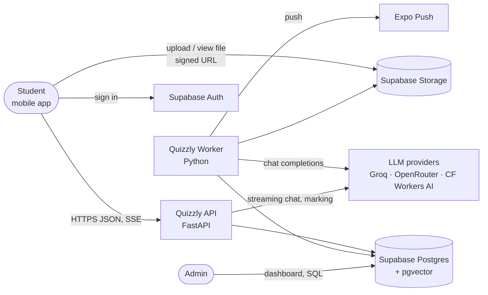
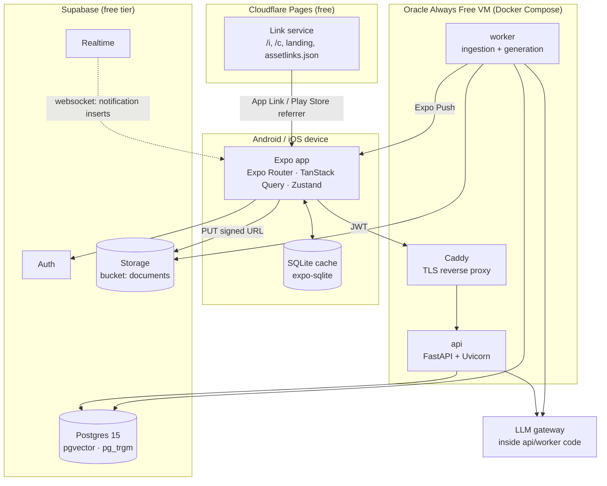
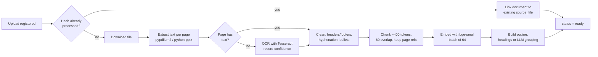
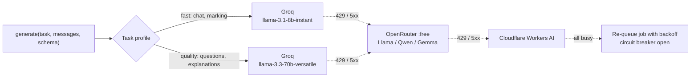

# Quizzly — Architecture

| | |
|---|---|
| **Status** | Draft v0.2 |
| **Date** | 2026-10-26 |
| **Related** | [PRD](PRD.md) · [FRD](FRD.md) · [Data models](DATA_MODELS.md) · [Data flows](DATA_FLOWS.md) |

---

## 1. Decisions at a glance

| Concern | Choice | Why |
|---|---|---|
| Mobile app | **React Native + Expo** (TypeScript, Expo Router) | One codebase for Android and iOS, free EAS builds, over-the-air updates |
| API | **FastAPI** (Python 3.12) | Best PDF/RAG tooling, async, automatic OpenAPI docs |
| Background work | **Python worker** using a **Postgres job queue** (`SELECT … FOR UPDATE SKIP LOCKED`) | No Redis or paid queue to run; jobs are just rows |
| Database | **Supabase Postgres + pgvector** | Relational data and vectors in one free database |
| Auth | **Supabase Auth** (email OTP, Google) | Free, issues JWTs the API verifies |
| File storage | **Supabase Storage** (private bucket, signed URLs) | 1 GB free; clients upload directly |
| LLM | **Open models on free hosted tiers**: Groq → OpenRouter (`:free` models) → Cloudflare Workers AI. Free-plan students start on the cheapest model (gpt-oss-20b) for chat, explanations and questions (FR-LIM-04) | ~$0 at MVP scale; no GPU to rent; free students cost about half on paid tiers |
| Embeddings | **`BAAI/bge-small-en-v1.5`** (384 dims) via `fastembed` (ONNX, CPU) inside the worker | Free, fast on CPU, no API quota used |
| PDF text | `pypdfium2` (Apache/BSD); PPTX via `python-pptx` | Permissive licences (PyMuPDF is AGPL, so avoided) |
| OCR | **Tesseract** in the worker container; vision-model OCR as a P1 fallback | Free; runs on CPU |
| Hosting (API + worker) | **Oracle Cloud Always Free ARM VM** (Docker Compose). Fallback: Koyeb / Render free tier | Always-free 4 vCPU / 24 GB RAM is enough for API, worker, OCR and embeddings |
| Push | Expo Push Service | Free |
| Real-time notifications (v0.2) | **Supabase Realtime** (`postgres_changes` on `notifications`, filtered by `user_id`) | Free tier includes 200 concurrent connections and 2M messages/month; no extra server |
| Invite and share links (v0.2) | **Link service**: a small static + edge route on `INVITE_DOMAIN` (Cloudflare Pages Functions, free) serving `/i/{code}`, `/c/{code}`, the landing page and `/.well-known/assetlinks.json`; Android App Links + **Play Install Referrer** (`getInstallReferrer()` from `react-native-device-info`; needs a development build, not Expo Go) | Firebase Dynamic Links shut down in Aug 2025; this needs no third party |
| Fonts (v0.2) | **Bricolage Grotesque** + **Manrope** via `@expo-google-fonts/*`, bundled | Brand type; no runtime download |
| Errors | Sentry free tier (app + API) | Free at this scale |
| CI | GitHub Actions | Free for public repos, 2,000 min/month for private |

## 2. System context



## 3. Containers



There are only two server processes, built from one Python codebase (`services/api`):

- **api** handles authenticated requests, creates jobs, serves cached content and streams chat.
- **worker** polls the `jobs` table and runs ingestion, outline, explanation, question and marking jobs, and (v0.2) progress updates, push sending, the 15-minute reminder scheduler, Sunday recaps, share fan-out, referral credits and storage cleanup.

Both share the same domain modules, so there is no separate service to keep in sync.

## 4. Repository layout (monorepo)

```
quizzly/
├── apps/
│   └── mobile/                # Expo app (TypeScript)
├── services/
│   └── api/                   # FastAPI app + worker (Python)
│       ├── app/
│       │   ├── api/           # routers (HTTP layer)
│       │   ├── core/          # config, auth, logging
│       │   ├── domain/        # documents, quizzes, chat… (business logic)
│       │   ├── rag/           # extract, ocr, chunk, embed, retrieve
│       │   ├── llm/           # provider gateway, prompts, schemas
│       │   └── worker/        # job loop + handlers
│       ├── prompts/           # versioned prompt files
│       └── tests/
├── supabase/
│   └── migrations/            # SQL schema, RLS policies
├── evals/                     # evaluation set + scripts (NFR-11)
├── docs/                      # PRD, FRD, architecture, data models, data flows
├── infra/                     # docker-compose, Caddyfile
└── .github/workflows/         # CI
```

## 5. Key designs

### 5.1 Ingestion pipeline (worker)



- Derived data hangs off **`source_files`** (one row per unique SHA-256), not off a user's document. Two students uploading the same WhatsApp PDF share pages, chunks, outline, explanations and question sets (PRD R3 / FR-DOC-06). This is the largest cost saving in the system.
- Each step updates `jobs.progress` so the app can show a percentage.

### 5.2 Retrieval

Hybrid search inside Postgres, so no separate vector database is needed:

1. Vector search: `embedding <=> query_embedding` on an HNSW index, restricted to `source_file_id` (and optionally topic IDs).
2. Keyword search: `tsvector` full-text rank on the same chunks.
3. Merge the two with **reciprocal rank fusion** and keep the top 6–8 chunks (about 3,000 tokens).

Question generation doesn't use similarity search alone. It walks the **topics** and samples chunks from each in proportion to its length (FR-QGEN-04), so quizzes cover the whole document.

### 5.3 LLM gateway



- All providers expose an **OpenAI-compatible** API, so one client class with a different `base_url` covers them all (NFR-12).
- Model names, priorities and per-provider rate limits live in `config/models.yaml`, never in code.
- Every structured output (questions, outlines, marking) is requested as **JSON**, validated with **Pydantic**, and repaired or retried once on failure.
- Every call writes an `llm_calls` row (provider, model, tokens, latency, estimated cost) for FR-LIM-02.
- A token-bucket limiter per provider (stored in Postgres) keeps us under free-tier RPM/TPM limits instead of finding them through 429s.

### 5.4 Caching layers

| Layer | Key | Effect |
|---|---|---|
| File dedup | `sha256` of the file | Identical uploads skip extraction, embedding and outlining |
| Explanation cache | `(source_file_id, topic_id, style, prompt_version)` | One generation serves every student with that file |
| Question-set cache | `(source_file_id, topic_ids hash, types, difficulty, count, prompt_version)` | Same as above for quizzes |
| On device | SQLite + TanStack Query persistence | Opened content works offline and isn't downloaded again |

### 5.5 Prompts and grounding

- Prompts are files under `services/api/prompts/<task>/v<N>.md`. The version number is stored on every generated row (NFR-10).
- Document text goes inside clearly marked `<document>` blocks with an instruction that it is data, not instructions (R6 / NFR-07).
- Questions must cite `chunk_id`s that were in the prompt. A validator rejects any citation that wasn't provided, and checks the answer is supported by the cited text (lexical overlap first, then an LLM judge on a sample).

### 5.6 Auth and security

- The app signs in with Supabase Auth and sends the access token (JWT) to the API. The API verifies it with the project's JWKS and reads `sub` as the user ID.
- The API connects to Postgres with the service role, so it **enforces ownership in code**. **Row-level security** is enabled on every table, and **(v0.2, FR-SEC-01) the `anon` and `authenticated` roles have `select` only**: the app may read its own rows directly (needed for Realtime), but every write goes through the API. The v0.1 `for all` policies are replaced in migration `0005`.
- Storage paths are generated by the server: uploads at `uploads/{user_id}/{document_id}/{n}.{ext}`, and the canonical copy of a processed file at `shared/{sha256}` (FR-SEC-07). The API never accepts a path from the client. Upload URLs expire after 10 minutes, page-view URLs after 5.
- Ingestion is bounded: max attempts on reclaimed jobs, pixel and zip-size caps, size checks before download, a 10-minute job timeout (FR-SEC-03/04).
- A daily global LLM budget trips the circuit breaker; sign-up and OTP requests are rate-limited (FR-SEC-08).
- Secrets live only in server environment variables. The app holds just the Supabase URL and anon key, which are public by design, and keeps session tokens in `expo-secure-store` (FR-AUTH-06).
- Production refuses to start without an explicit `ENV`, disables `/docs`, and uses a CORS allowlist (FR-SEC-15).

### 5.7 Mobile app

- **Expo Router** for navigation; **TanStack Query** for server state, persisted to SQLite for offline use; **Zustand** for small UI state.
- An **outbox** table in SQLite queues offline quiz answers and attempts, each with a client-generated UUID as an idempotency key (FR-OFF-02).
- Chat streaming uses **Server-Sent Events** over `fetch`, so no WebSocket infrastructure is needed.
- Math rendering uses KaTeX in a lightweight WebView only on screens that need it, keeping the rest of the app light for 2 GB phones. **(v0.2)** KaTeX is bundled; the WebView loads local content only (FR-SEC-16).
- **(v0.2) Tabs:** Today (home), Library, Practice, Account. Today reads `GET /home` (one small payload: countdown, readiness, week, plan, unread count).
- **(v0.2) Notifications:** one Realtime channel per signed-in user, opened on foreground and closed on background (`AppState`). Inserts show a toast and bump the badge; on reconnect the app fetches unread rows since the last ID it has (FR-NOTIF-07). `expo-notifications` registers the push token and routes taps.
- **(v0.2) Links:** Expo Router handles `/i/[code]` and `/c/[code]`; `intentFilters` with `autoVerify` in `app.json` for `INVITE_DOMAIN`. On first launch the app reads the Play Install Referrer once and keeps the pending code in secure storage until after onboarding (FR-AUTH-07).
- **(v0.2) Recap image:** rendered on the device with `react-native-view-shot` and shared with `expo-sharing`; no server image rendering.

### 5.8 Progress engine (v0.2)

- After answers are saved, the API enqueues `update_mastery` (deduped per user). The worker recomputes `topic_mastery` for the touched topics, updates `review_queue` (Leitner boxes 1/3/7/14 days), `study_days`, and inserts `achievements` (first mastery, personal best, readiness +10, weekly goal, theme unlocks).
- A nightly job writes `readiness_snapshots` per user and course for "up X% this week".
- `GET /home` and `GET /daily5` read only these tables, so Today loads in one query batch (< 50 KB, NFR-02).

### 5.9 Sharing (v0.2)

- Sharing reuses the existing shared-derived-data design: a member reads the same `topics`, `explanations` and `question_sets` rows the owner reads. Access is a SQL function `is_course_member(course_id)` used by RLS and the API.
- Members never get storage URLs; citations in a shared course return the quoted chunk text instead of a page image (FR-SHARE-02).
- Quizzes a member creates are their own rows and count against their own limits; generation cache hits are still free.
- Owner adds a document → once `ready`, `fan_out_share_update` inserts one batched notification per member (FR-SHARE-06).

## 6. Cost strategy

| Item | Beta (≤ 200 MAU) | 2,000 MAU |
|---|---|---|
| Supabase | Free (500 MB DB, 1 GB storage) | Pro $25/mo (8 GB DB, 100 GB storage) |
| API + worker VM | Oracle Always Free: $0 | $0 (same VM), or ~$10/mo for a paid VPS |
| LLM | Free tiers: $0 | Mostly cache hits; overflow on Groq pay-as-you-go ≈ $10–40/mo |
| Embeddings, OCR | $0 (CPU in worker) | $0 |
| Push, Sentry, CI | $0 | $0 |
| Realtime | $0 (free tier: 200 concurrent) | Pro includes 500 concurrent; foreground-only subscriptions keep this low |
| Link service (Cloudflare Pages) + domain | ≈ $10/yr domain | same |
| Play Store | One-time $25 | — |
| **Total** | **≈ $0/mo** | **≈ $35–75/mo** (≤ $0.04 per MAU) |

The levers, from most to least effective:

1. **Share derived data** between identical files (one generation, many readers). **Course sharing (v0.2)** extends this: a class of 300 sharing one course costs one ingestion.
2. **Cache by key** and serve repeats without any LLM call.
3. **Use the small model** for chat and marking, and the large one only for questions and explanations.
4. **Keep prompts tight**: about 3k tokens of context, never whole documents.
5. **Daily per-user limits** protect the shared free quota.
6. **Run embeddings and OCR locally on CPU** instead of paying per call.

Storage watch: 384-dim vectors are about 1.5 KB each. 100k chunks (about 2,500 decks) take roughly 150 MB, including the index, which fits the free database. Original files are the bigger cost, so files whose documents are all deleted are purged, and inactive files can be archived to cheaper storage later.

## 7. Scaling path

| Trigger | Change |
|---|---|
| Queue latency > 1 min | Run a second worker container (jobs already use `SKIP LOCKED`) |
| DB > 400 MB or storage > 800 MB | Upgrade to Supabase Pro |
| Free-tier LLM limits hit daily | Add a paid Groq key as the last fallback, with a monthly spend cap |
| > 20k MAU | Move the worker to its own VM; consider Cloudflare R2 for files (no egress fees) |

## 8. Environments

| Env | Database | Deploy |
|---|---|---|
| local | Supabase CLI (`supabase start`, Docker) | `docker compose up` + `npx expo start` |
| staging | Free Supabase project #2 | GitHub Actions on merge to `main`; EAS Update `preview` channel |
| production | Supabase project | `v*` release tag + approval; EAS Update or build on the `production` channel |

Both run on the same VM and roll back automatically when their checks fail. Pipeline, rollback and setup: [CI_CD.md](CI_CD.md).

## 9. Observability

- Structured JSON logs with `request_id` and `job_id`.
- A `/healthz` endpoint for API liveness. The worker writes a heartbeat row every minute, which doubles as the Supabase keep-alive (PRD R5).
- The admin cost view is a SQL view over `llm_calls` grouped by day, provider and model.
