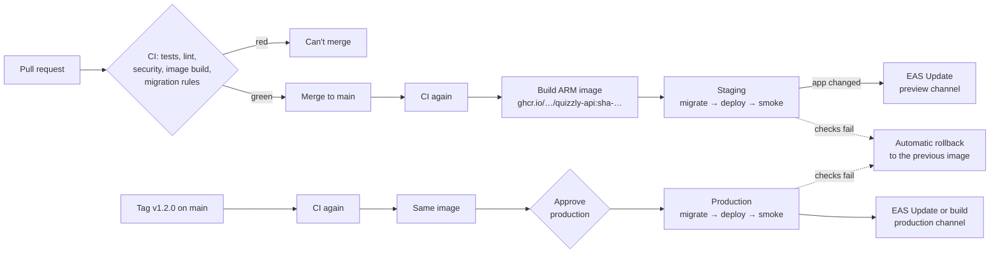

# Quizzly — CI/CD

| | |
|---|---|
| **Workflows** | [`ci.yml`](../.github/workflows/ci.yml) · [`deploy.yml`](../.github/workflows/deploy.yml) · [`_deploy.yml`](../.github/workflows/_deploy.yml) · [`rollback.yml`](../.github/workflows/rollback.yml) |
| **Server side** | [`infra/deploy.sh`](../infra/deploy.sh) · [`infra/smoke.sh`](../infra/smoke.sh) · [`infra/docker-compose.yml`](../infra/docker-compose.yml) · [`infra/edge/`](../infra/edge/) |
| **Related** | [Architecture §8 Environments](ARCHITECTURE.md#8-environments) |

## 1. Pipeline at a glance



- **Nothing ships without CI.** `deploy.yml` calls `ci.yml` first, and `main` requires every CI job to pass before a merge.
- **Build once, promote the same image.** The image is tagged with the commit (`sha-<12 chars>`), so production runs exactly what staging ran. `RELEASE` (Sentry) is the same tag.
- **Staging is automatic, production is a decision.** Every merge to `main` deploys to staging. Production deploys when you publish a `v*` tag on a commit that's on `main`, after you approve it.

## 2. Pull requests (`ci.yml`)

| Job | What it checks |
|---|---|
| `api` | `ruff check`, `ruff format --check`, `pytest` |
| `mobile` | `tsc --noEmit`, `expo lint`, `expo-doctor` |
| `web` | `eslint`, `next build` |
| `migrations` | Every migration applies, in order, to a fresh Postgres with pgvector |
| `migration-rules` | Applied migrations unchanged; new ones numbered after the last; no drops or renames without the `destructive-migration` label (§4) |
| `security` | gitleaks over the whole git history; Semgrep high-severity rules for Python, TypeScript and React |
| `api-image` | The Docker image builds for the VM's ARM CPU |
| `evals` | Only when prompts, `app/rag/` or `models.yaml` change: the eval set against the real models (NFR-11) |

False-positive secrets go in [`.gitleaksignore`](../.gitleaksignore) by fingerprint. A real secret gets rotated, never listed there.

Dependabot ([`dependabot.yml`](../.github/dependabot.yml)) updates the actions and the base image weekly, and raises security fixes for npm and Python dependencies.

## 3. Deploys

Each environment runs one job on GitHub (one approval for production), then updates the app:

1. **Check configuration**: the environment has `API_URL` and `SUPABASE_DB_URL`.
2. **Migrate**: `supabase db push` applies new files from `supabase/migrations/`, after a dry run.
3. **Deploy**: copies `docker-compose.yml` and `deploy.sh` to the VM over SSH (host key pinned) and runs `deploy.sh <env> <image>`. The script pulls the image, restarts the API and worker, and waits until `/readyz` answers (the API reached the database) and the worker stays up for 20 seconds. If either fails, it starts the previous image again and the job fails.
4. **Smoke test** from outside through Caddy and TLS (`smoke.sh`): `/healthz`, `/readyz`, the running release, and `/v1/me` refusing a missing or forged token. A failure rolls back to the previous image.
5. **App**: only after the backend is healthy, and for staging only when `apps/mobile` changed. Expo's fingerprint action compares the native fingerprint with existing EAS builds:
   - same fingerprint (JavaScript-only change): publishes an **EAS Update** to installed apps on that channel;
   - new fingerprint (native change): starts an **EAS build** (and, for production, submits it to the Play internal track), because an update can't reach a build with a different runtime.

Deploys to one environment never overlap; a newer one waits for the running one.

## 4. Database migrations and rollback safety

A rollback restores the previous **image**, never the previous **schema**. So every migration must keep working with the code that's running before and after it ("expand, then contract"):

- **Allowed any time**: new tables, new nullable columns or columns with defaults, new indexes, new policies, new functions.
- **Two releases**: to remove or rename something, first ship code that stops using it, then drop it in a later PR labelled `destructive-migration`. `migration-rules` blocks drops, renames, type changes, `set not null` and `truncate` without that label.
- **Never edit an applied migration** (CLAUDE.md). CI rejects edits and deletions under `supabase/migrations/`.

If a migration fails halfway, the deploy stops before the new code starts. Fix it with a new migration.

## 5. Rollback

| What | Automatic | By hand |
|---|---|---|
| API + worker | `deploy.sh` when `/readyz` or the worker fails; the smoke test step when the public checks fail | **Actions → Rollback → Run workflow**: pick the environment; leave the image blank for the one before the current, or paste any `ghcr.io/…:sha-…` tag |
| Database | Never (§4) | A new migration that undoes the change |
| App (EAS Update) | Never: a bad update is only published after the backend passed | expo.dev → project → **Updates** → pick the last good update group → **Republish**, or `eas update:republish --group <id>` |
| App (store build) | — | Promote the previous build in Play Console |

The VM keeps the last two good images in `/opt/quizzly/<env>/.deploy/{current,previous}`. A manual rollback swaps them, so running it twice returns to where you started.

## 6. One-time setup

### VM (Oracle Cloud ARM)

```bash
# as an admin user on the VM
sudo adduser --disabled-password deploy && sudo usermod -aG docker deploy
sudo mkdir -p /opt/quizzly/staging /opt/quizzly/production && sudo chown -R deploy: /opt/quizzly
# one .env per environment, from services/api/.env.example (ENV=staging / ENV=production)
sudoedit /opt/quizzly/staging/.env
sudoedit /opt/quizzly/production/.env
```

On your computer, make a key used only for deploys and allow it on the VM:

```bash
ssh-keygen -t ed25519 -N "" -C quizzly-deploy -f quizzly-deploy
# copy quizzly-deploy.pub into /home/deploy/.ssh/authorized_keys on the VM
ssh-keyscan -t ed25519 <vm-ip-or-host>   # the line for DEPLOY_KNOWN_HOSTS
```

Point two DNS records at the VM (for example `api.quizzly.app` and `staging-api.quizzly.app`), open ports 80 and 443, and start Caddy once (see [infra/README.md](../infra/README.md)).

### GitHub

**Settings → Secrets and variables → Actions → Repository secrets**

| Secret | Value |
|---|---|
| `DEPLOY_HOST` | VM IP or hostname |
| `DEPLOY_USER` | `deploy` |
| `DEPLOY_SSH_KEY` | Contents of the private key `quizzly-deploy` |
| `DEPLOY_KNOWN_HOSTS` | The `ssh-keyscan` line |
| `EXPO_TOKEN` | expo.dev → Account settings → Access tokens (optional: without it the app step is skipped) |

**Settings → Environments**: create `staging` and `production`.

| | `staging` | `production` |
|---|---|---|
| Variable `API_URL` | `https://staging-api.quizzly.app` | `https://api.quizzly.app` |
| Secret `SUPABASE_DB_URL` | Staging project's connection string | Production project's connection string |
| Deployment branches and tags | `main` | Tags `v*`, and `main` (so **Rollback** can run) |
| Required reviewers | — | You |

Use the **Session pooler** connection string (Supabase → Connect). The direct connection is IPv6 only, and GitHub's runners can't reach it. Percent-encode special characters in the password.

**Settings → Branches → Add rule for `main`**: require a pull request, require status checks `api`, `mobile`, `web`, `migrations`, `migration-rules`, `security`, `api-image` and `evals`, and require branches to be up to date. Optionally create the `destructive-migration` label.

### Supabase migration history

`supabase db push` tracks what it applied in `supabase_migrations.schema_migrations`. A database whose migrations were run by hand has no history, so the deploy stops instead of re-running `0001`. Record the files already applied, once per project, in the SQL editor. **List only the migrations that database really has**:

```sql
create schema if not exists supabase_migrations;
create table if not exists supabase_migrations.schema_migrations (
  version text primary key, statements text[], name text
);
insert into supabase_migrations.schema_migrations (version, name) values
  ('0001', 'init'), ('0002', 'seed_institutions'), ('0003', 'jobs_dedupe_key_index'),
  ('0004', 'documents_image_count'), ('0005', 'client_read_only'), ('0006', 'server_storage_paths'),
  ('0007', 'failure_reason_crashed'), ('0008', 'documents_processing_started'),
  ('0009', 'cleanup_storage_job'), ('0010', 'llm_daily_costs'), ('0011', 'engagement_sharing'),
  ('0012', 'daily5_and_reading'), ('0013', 'sharing_access'), ('0014', 'member_count_definer'),
  ('0015', 'invite_code_from_name'), ('0016', 'flashcards'), ('0017', 'past_papers')
on conflict do nothing;
```

A brand-new staging project needs nothing: the first deploy applies every migration.

### Expo (EAS)

- Set the app's variables per EAS environment (`preview` → staging, `production` → production): `EXPO_PUBLIC_API_URL`, `EXPO_PUBLIC_SUPABASE_URL`, `EXPO_PUBLIC_SUPABASE_ANON_KEY`, `EXPO_PUBLIC_SENTRY_DSN`. For example `eas env:create --environment preview --name EXPO_PUBLIC_API_URL --value https://staging-api.quizzly.app --visibility plaintext`.
- `expo-updates` is new native code, so the first run per channel starts a build. Install that build on test phones; later JavaScript-only changes arrive as updates.

## 7. Releasing to production

1. Check staging after the merges you want to ship.
2. **GitHub → Releases → Draft a new release** → new tag `v1.2.0` on `main` → **Publish**.
3. **Actions → Deploy** → the run waits for `production` approval → **Review deployments → Approve**.

## 8. Known limits

- The API is down for a few seconds while its container restarts. Move to two API replicas behind Caddy if that starts to matter.
- Staging and production share the VM. A runaway staging worker can slow production; cap it with `deploy.resources` in the compose file if it happens.
- `apps/web` is built and linted in CI but not deployed yet (BUILD_PLAN D6, Cloudflare).
- `continuous-deploy-fingerprint` is published by Expo from `main` only and is marked as still in development.
