# Quizzly — Data Flow Diagrams

| | |
|---|---|
| **Status** | Draft v0.2 |
| **Date** | 2026-10-26 |
| **Related** | [Architecture](ARCHITECTURE.md) · [Data models](DATA_MODELS.md) |

**Notation used in every diagram:**

- `[Rectangle]` is an external entity (Student, Admin, LLM provider…).
- `(Rounded)` is a process.
- `[(Cylinder)]` is a data store (a table or a bucket).
- Arrow labels name the data that moves.

Process numbers match the level-1 diagram.

---

## 1. Level 0: context diagram

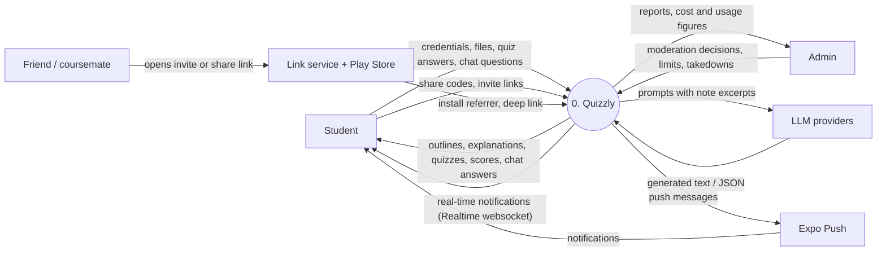

> **v0.2 note:** every write arrow from the Student below goes through the API (FR-SEC-01); the app only reads tables directly.

## 2. Level 1: main processes

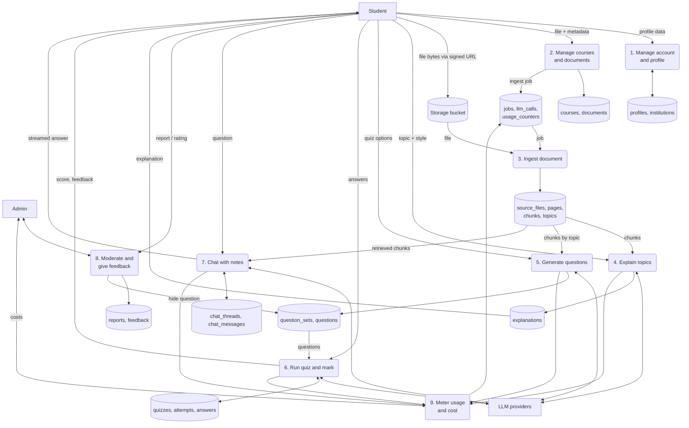

---

## 3. Per-entity data flows

Each entity gets a diagram showing where its data comes from, which processes change it, and who reads it, followed by notes on create (C), read (R), update (U) and delete (D).

### 3.1 `profiles`

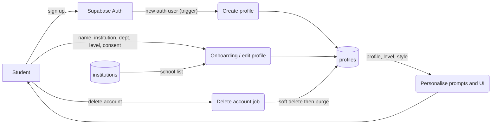

- **C:** a database trigger on `auth.users` insert. **U:** onboarding and settings. **R:** the app header and prompt context (level, preferred style). **D:** the `delete_account` job (FR-AUTH-05).

### 3.2 `institutions`

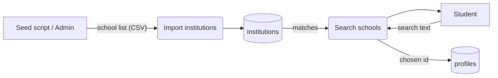

- **C/U/D:** admin only, through migrations or a seed script. **R:** the onboarding search (trigram match).

### 3.3 `courses`

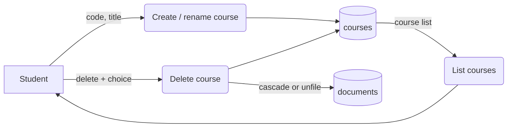

- **R:** the home screen. **D:** asks whether to delete documents or move them to Unfiled (FR-CRS-03).

### 3.4 `documents`

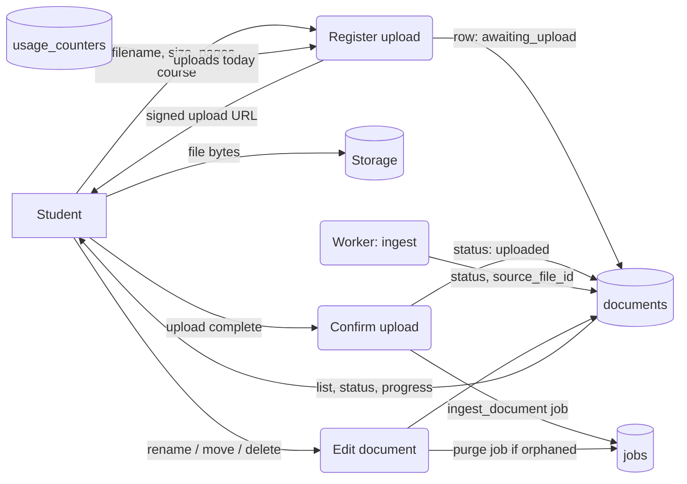

- **C:** `POST /documents` checks the limits (FR-DOC-02). **U:** confirmation, the worker's status updates, and edits by the student. **D:** cascades to quizzes and chats; a purge job runs if the source file is orphaned.

### 3.5 `source_files`

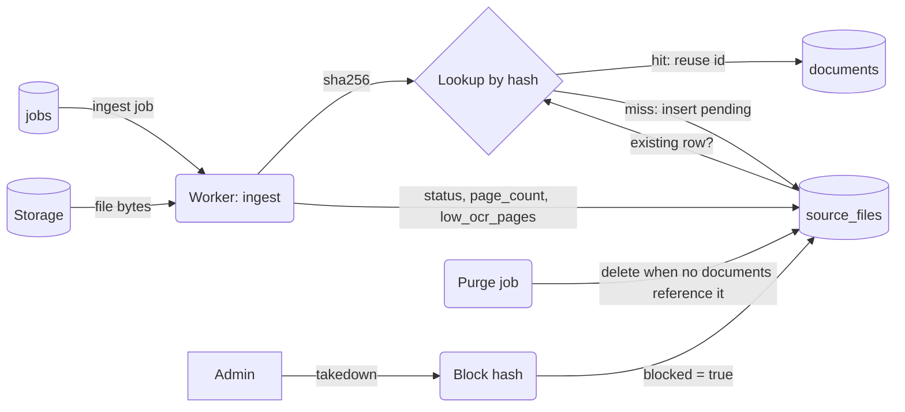

- **C:** the worker, on a hash miss. **R:** dedup lookups and the document screen. **U:** the processing pipeline and takedowns. **D:** the purge job, once the reference count reaches zero.

### 3.6 `pages`

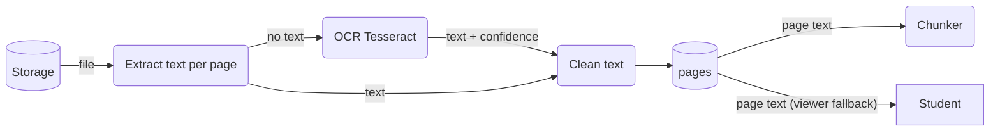

- **C:** the ingest pipeline. **R:** the chunker, and the citation page view. **D:** purged with the source file.

### 3.7 `chunks`

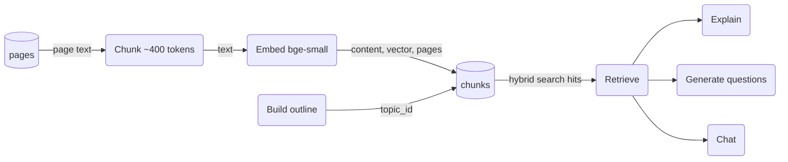

- **C:** chunk and embed. **U:** `topic_id` is set when the outline is built. **R:** retrieval for explanations, questions and chat. **D:** purge.

### 3.8 `topics`

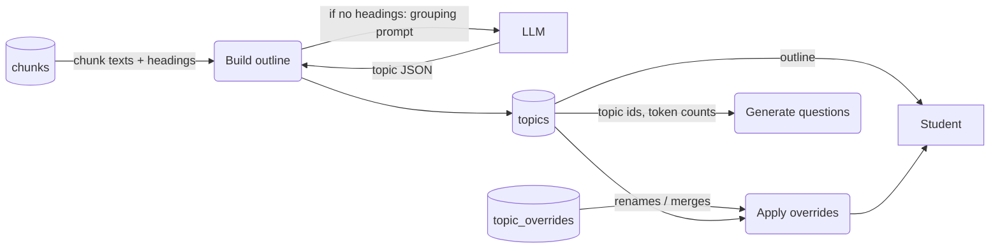

- **C:** the outline step of ingestion. **R:** the outline screen and question allocation. **D:** purge.

### 3.9 `topic_overrides` (P1)

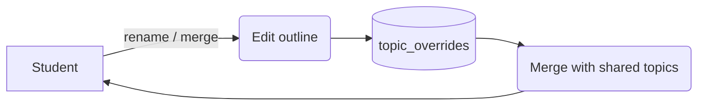

- Overrides are private. They never change the shared `topics` rows.

### 3.10 `explanations`

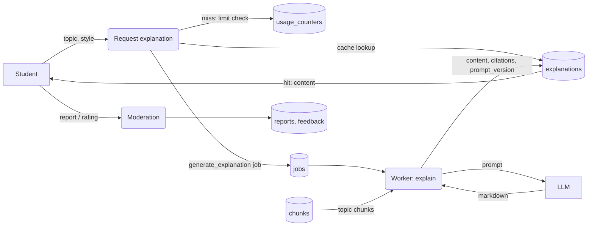

- **C:** the worker, on a cache miss. **R:** every student with the same file. **U:** none (a new prompt version creates a new row). **D:** purge.

### 3.11 `question_sets`

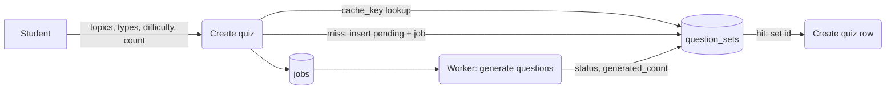

- **C:** a cache miss, or "New questions" (`variant + 1`). **R:** quiz creation. **U:** the worker sets the status. **D:** purge.

### 3.12 `questions`

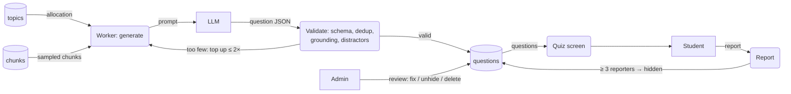

- **C:** the generation worker, after validation. **R:** quizzes, and marking (answer + rubric). **U:** `report_count`, `hidden`, admin fixes. **D:** purge or admin.

### 3.13 `quizzes`

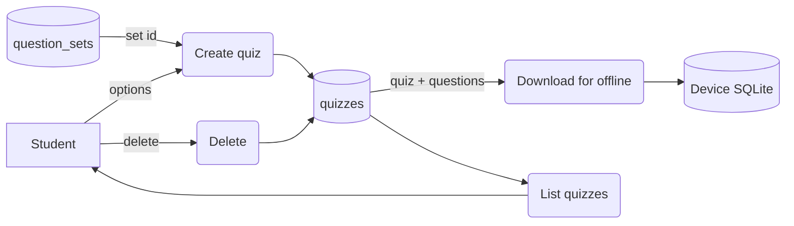

- **R:** the quiz list and the offline cache. **D:** by the student, or when the document is deleted.

### 3.14 `quiz_attempts`

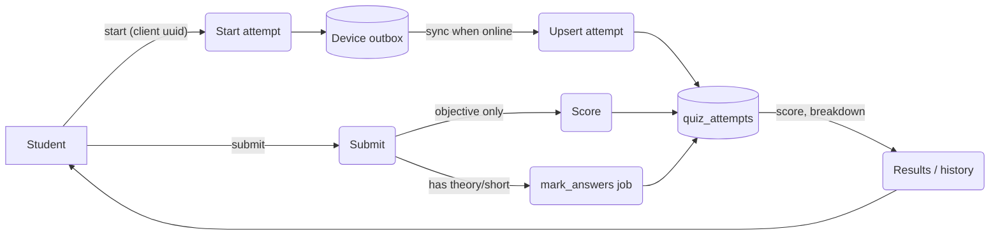

- **C:** a client-generated ID makes offline syncs idempotent (FR-OFF-02). **U:** progress, submit, marking. **R:** results and weak topics.

### 3.15 `attempt_answers`

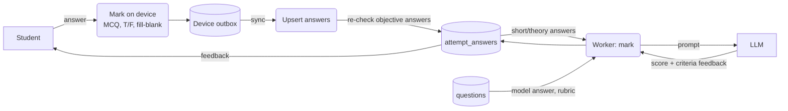

- The server re-scores objective answers so scores can't be faked on the device. The LLM marks only free-text answers.

### 3.16 `chat_threads`

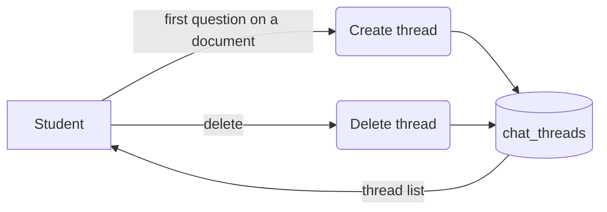

### 3.17 `chat_messages`

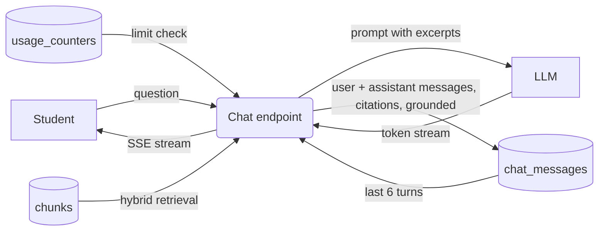

- **C:** each turn stores the student's message and the assistant's reply. **R:** thread history. **D:** with the thread, the document or the account.

### 3.18 `reports`

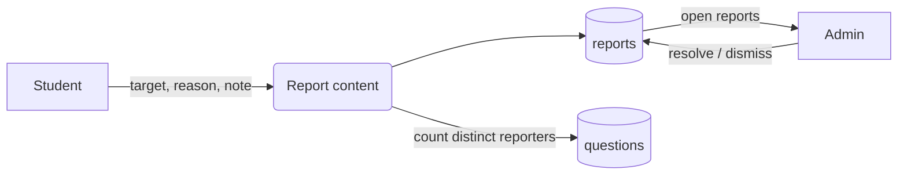

### 3.19 `feedback`

```mermaid
flowchart LR
    S[Student] -- "thumbs up/down" --> F(Rate)
    F --> DF[(feedback)]
    DF -- "aggregates by prompt_version" --> AN(Quality analysis) --> A[Admin]
```

### 3.20 `jobs`

```mermaid
flowchart LR
    API(API endpoints) -- "enqueue (dedupe_key)" --> DJ[(jobs)]
    DJ -- "claim: FOR UPDATE SKIP LOCKED" --> W(Worker loop)
    W -- "progress %" --> DJ
    W -- "success / failure / retry with run_after" --> DJ
    DJ -- "status, progress" --> API --> S[Student]
    W -- "on finish" --> PU(Send push) --> E[Expo Push]
```

- Retries use exponential backoff. When an LLM rate limit is hit, the job is put back with `run_after`, so it waits instead of failing (FR-LIM-03).

### 3.21 `llm_calls`

```mermaid
flowchart LR
    GW(LLM gateway) -- "provider, model, tokens, latency, status" --> DLC[(llm_calls)]
    DLC -- "daily cost view" --> A[Admin]
    DLC -- error rates --> CB(Circuit breaker) --> DPL[(provider_limits)]
```

### 3.22 `usage_counters`

```mermaid
flowchart LR
    API(Metered endpoint) -- "check count < limit" --> DU[(usage_counters)]
    API -- "increment on success (not on cache hit)" --> DU
    DU -- "remaining today" --> S[Student]
    DU -- "over limit → 429 with reset time" --> S
```

### 3.23 `push_tokens`

```mermaid
flowchart LR
    S[Student device] -- "Expo push token" --> R(Register token) --> DPT[(push_tokens)]
    DPT -- tokens --> W(Worker: notify) --> E[Expo Push]
    E -- "invalid token receipt" --> CL(Clean up) --> DPT
```

### 3.24 `provider_limits`

```mermaid
flowchart LR
    GW(LLM gateway) -- "reserve request + tokens" --> DPL[(provider_limits)]
    DPL -- "allowed / wait time" --> GW
    GW -- "429 burst → open circuit" --> DPL
    CFG[models.yaml] -- "RPM / TPM limits" --> GW
```

### 3.25 `worker_heartbeats`

```mermaid
flowchart LR
    W(Worker) -- "every 60 s" --> DH[(worker_heartbeats)]
    DH -- "stale > 3 min" --> AL(Alert / restart) --> A[Admin]
    DH -. "keeps Supabase project active" .-> SB[Supabase]
```

### 3.26 Progress: `topic_mastery`, `readiness_snapshots`, `study_days`, `review_queue`, `achievements` (v0.2)

```mermaid
flowchart LR
    S[Student] -- "answers (online or synced outbox)" --> API(Save attempt answers)
    API -- "enqueue update_mastery" --> J[(jobs)]
    J --> W(Worker: update progress)
    W -- "recency-weighted accuracy" --> DTM[(topic_mastery)]
    W -- "box / due_on" --> DRQ[(review_queue)]
    W -- "questions, reading time" --> DSD[(study_days)]
    W -- "nightly per course" --> DRS[(readiness_snapshots)]
    W -- "first mastery, PB, goal met, unlocks" --> DAC[(achievements)]
    DTM & DRS & DSD --> T(Today home) --> S
    DRQ -- "due questions" --> D5(Daily 5 picker) --> S
    DAC -- "unseen" --> C(Celebration) --> S
```

- **C/U:** only the worker (`update_mastery` job after each attempt/answer batch, nightly snapshot). Reading time comes from the explanation screen as a batched event.
- **R:** the student reads their own rows (select-only RLS).
- **D:** account deletion; leaving a shared course keeps mastery rows (history), revoked courses hide them from Today.

### 3.27 Sharing: `course_shares`, `course_members`, `user_blocks` (v0.2)

```mermaid
flowchart LR
    O[Owner] -- "share course / pick coursemates / regenerate / stop" --> SH(Share API)
    SH -- "check owner, ready docs, limits, blocks, share_permission" --> DCS[(course_shares)]
    SH -- "pending rows" --> DCM[(course_members)]
    SH -- "course_shared" --> DN[(notifications)]
    R[Recipient] -- "Add to library / Not now / Leave" --> SH
    LK[Link /c/code] -- "resolve (rate-limited)" --> SH
    DCM -- "is_course_member()" --> RLS(RLS on derived content) --> R
    R -- "block user" --> DB[(user_blocks)] --> SH
    A[Admin] -- "take down" --> DCS
```

- Owners never see members' activity, only names and the count. Members never get file URLs.
- Adding a document to a shared course enqueues `fan_out_share_update` once it is ready (batched notification, FR-SHARE-06).

### 3.28 `notifications` and `notification_settings` (v0.2)

```mermaid
flowchart LR
    EV(Server events: share, ready, recap, reminder, invite credit) -- "insert (dedupe_key)" --> DN[(notifications)]
    DN -- "Realtime INSERT (user_id = me)" --> APP[App in foreground: toast + badge]
    DN -- "enqueue send_push if app not active" --> W(Worker: send_push)
    DNS[(notification_settings)] -- "types, quiet hours" --> W
    W -- tokens --> DPT[(push_tokens)]
    W --> E[Expo Push] --> DEV[Device]
    APP -- "mark read / mark all read (API)" --> DN
    APP -- "catch-up: unread since last id" --> DN
```

### 3.29 `referrals` and `waitlist` (v0.2)

```mermaid
flowchart LR
    F[Friend] -- "taps /i/CODE" --> LS(Link service)
    LS -- "app installed" --> APP[App opens with code]
    LS -- "Android, no app" --> PS[Play Store + referrer]
    PS -- "install referrer on first launch" --> APP
    LS -- "iPhone" --> WL(Waitlist form) --> DWL[(waitlist)]
    APP -- "pending code after sign-up" --> API(Referral API) --> DR[(referrals: pending)]
    API -- "verified + onboarded + 5 answers" --> J[(jobs: credit_referral)]
    J --> W(Worker) -- "checks self, device, cap" --> DR
    W -- "invite_joined" --> DN[(notifications)]
    W -- "3 credited → Lavender" --> DAC[(achievements)]
```

---

## 4. End-to-end sequences

### 4.1 Upload to ready

```mermaid
sequenceDiagram
    autonumber
    participant App
    participant API
    participant DB as Postgres
    participant St as Storage
    participant W as Worker
    App->>API: POST /documents {filename, size, pages, course_id}
    API->>DB: check limits, insert document (awaiting_upload)
    API-->>App: {document_id, signed_upload_url}
    App->>St: PUT file
    App->>API: POST /documents/{id}/uploaded
    API->>DB: status=uploaded, enqueue ingest_document
    W->>DB: claim job
    W->>St: download, sha256
    alt hash already processed
        W->>DB: link source_file, status=ready
    else new file
        W->>W: extract → OCR → clean → chunk → embed
        W->>DB: pages, chunks
        W->>W: build outline (LLM if no headings)
        W->>DB: topics, status=ready
    end
    W-->>App: push "Your notes are ready"
    App->>API: GET /documents/{id}/outline
```

### 4.2 Generate a quiz

```mermaid
sequenceDiagram
    autonumber
    participant App
    participant API
    participant DB as Postgres
    participant W as Worker
    participant LLM
    App->>API: POST /quizzes {document_id, topic_ids, types, difficulty, count}
    API->>DB: lookup question_set by cache_key
    alt cache hit
        API->>DB: insert quiz
        API-->>App: quiz (ready)
    else miss
        API->>DB: check + increment usage, insert set (pending), enqueue job, insert quiz
        API-->>App: quiz (generating)
        W->>DB: claim job, load topics + chunks
        loop per topic batch
            W->>LLM: grounded question prompt (JSON)
            LLM-->>W: questions
            W->>W: validate (schema, dedup, grounding)
        end
        W->>DB: questions, set=ready
        App->>API: poll GET /quizzes/{id}
        API-->>App: questions
    end
```

### 4.3 Chat

```mermaid
sequenceDiagram
    autonumber
    participant App
    participant API
    participant DB as Postgres
    participant LLM
    App->>API: POST /chat/{thread_id}/messages {text}
    API->>DB: limit check, last 6 turns
    API->>API: embed question (bge-small)
    API->>DB: hybrid search chunks (source_file)
    API->>LLM: stream completion with excerpts
    LLM-->>API: tokens
    API-->>App: SSE tokens + final citations
    API->>DB: save both messages
```

### 4.4 Share a course in Quizzly (real time)

```mermaid
sequenceDiagram
    autonumber
    participant O as Owner app
    participant API
    participant DB as Postgres
    participant RT as Realtime
    participant W as Worker
    participant R as Recipient app
    O->>API: POST /courses/{id}/share {recipients:[user_id|code]}
    API->>DB: owner? ready docs? limits? blocks? share_permission?
    API->>DB: upsert course_shares (active), insert course_members (pending)
    API->>DB: insert notifications (course_shared) per recipient
    DB-->>RT: INSERT event
    RT-->>R: notification (app open) → toast + badge ≤ 2 s
    API->>W: enqueue send_push (recipients not active)
    R->>API: GET /shares/{member_id} (preview, screen 20)
    R->>API: POST /shares/{member_id}/accept
    API->>DB: member active, member_count + 1
    R->>API: GET /courses (now includes "Shared by Ada")
```

### 4.5 Join with a link after installing

```mermaid
sequenceDiagram
    autonumber
    participant F as Friend's phone
    participant LS as Link service
    participant PS as Play Store
    participant App
    participant API
    F->>LS: GET /c/7KQ2ABCD (from WhatsApp)
    alt app installed
        LS-->>F: Android App Link → app opens /c/7KQ2ABCD
    else not installed
        LS-->>F: redirect Play Store ?referrer=share%3D7KQ2ABCD
        F->>PS: install
        App->>App: first launch: read Install Referrer once, store pending code
    end
    App->>API: sign in + onboarding
    App->>API: POST /shares/join {code}
    API-->>App: member (active) → Join screen 20 → Today
```

### 4.6 Daily reminder

```mermaid
sequenceDiagram
    autonumber
    participant W as Worker (every 15 min)
    participant DB as Postgres
    participant E as Expo Push
    W->>DB: users whose local reminder time falls in this window
    W->>DB: skip if study_days.counted today, quiet hours, or 2 pushes sent today
    W->>DB: insert notification (reminder_due / reminder_exam)
    W->>E: send push
    E-->>W: receipts (remove invalid tokens)
```
