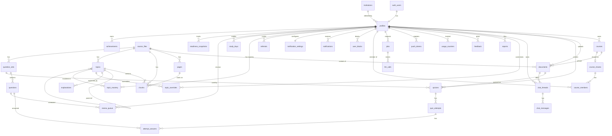
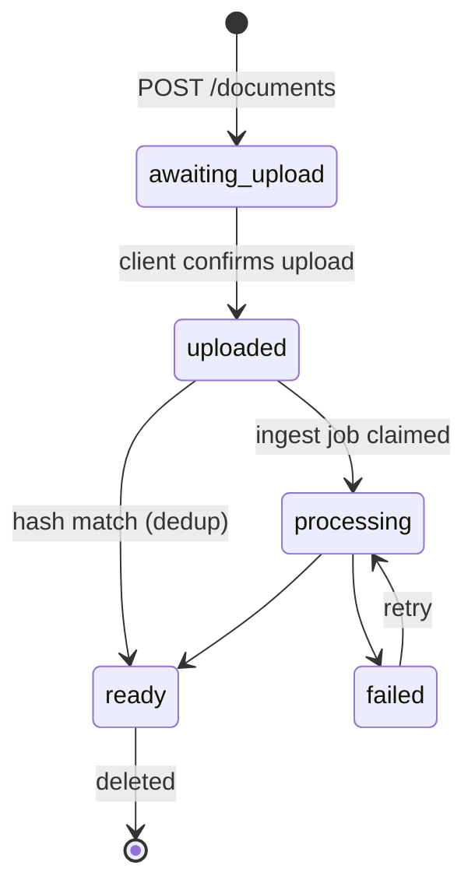
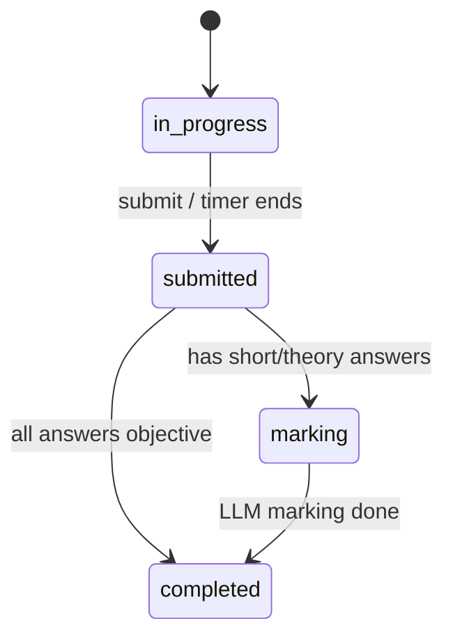
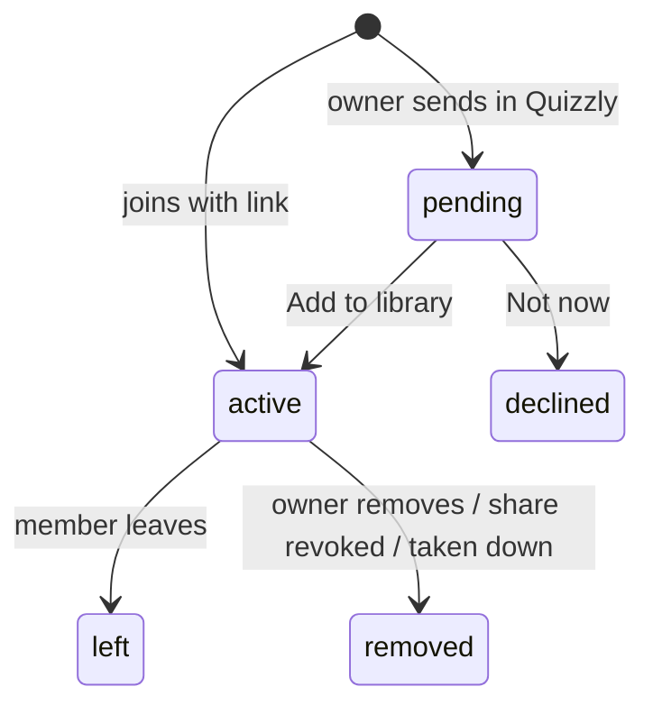

# Quizzly — Data Models

| | |
|---|---|
| **Status** | Draft v0.2 |
| **Date** | 2026-10-26 |
| **Related** | [Architecture](ARCHITECTURE.md) · [Data flows](DATA_FLOWS.md) · SQL: [`supabase/migrations/0001_init.sql`](../supabase/migrations/0001_init.sql) |

All tables live in Postgres (Supabase). IDs are `uuid` (default `gen_random_uuid()`), and timestamps are `timestamptz`. Every table has `created_at`; mutable tables also have `updated_at`.

The model has two groups of data:

- **User-owned data** (blue below) belongs to one student. It is protected by row-level security and deleted when the student deletes it or their account.
- **Shared derived data** (green below) hangs off a `source_file`, which is unique per file hash. It is never exposed with any link to who uploaded the file. It is deleted when no document references the file any more.
- **Social and progress data (v0.2, orange below):** sharing, notifications, invites and progress. Each row has one owner who can read it; shared-course members read derived content through membership checks.

**Access rule (v0.2, FR-SEC-01):** the mobile app has **select-only** access through RLS. Every insert, update and delete goes through the API or the worker using the service role. See §5.

## 1. Entity-relationship diagram

## 2. Entities

### 2.1 Identity

#### `profiles` (user-owned)
One row per Supabase Auth user, created by a trigger on `auth.users`.

| Column | Type | Notes |
|---|---|---|
| id | uuid PK | = `auth.users.id` |
| full_name | text | |
| institution_id | uuid FK → institutions | nullable until onboarding |
| institution_other | text | free text if the school isn't listed |
| department | text | |
| level | text | `100L`…`700L`, `other` |
| explanation_style | enum `explanation_style` | default `standard` |
| plan | enum `plan` | `free` (later `premium`) |
| terms_version | text | consent (FR-AUTH-03) |
| terms_accepted_at | timestamptz | |
| deleted_at | timestamptz | soft-delete marker during account deletion |
| display_name | text | **v0.2** first name + last initial ("Ada O."), the only name other users ever see |
| timezone | text | **v0.2** IANA zone, default `Africa/Lagos` (study days, reminders) |
| weekly_goal_days | smallint | **v0.2** 1–7, default 4 (FR-HAB-03) |
| accent | enum `accent` | **v0.2** `ink`, `lagoon`, `ankara`, `palm`, `lavender`; default `ink` |
| night_mode | bool | **v0.2** default true |
| low_data_mode | bool | **v0.2** default false |
| share_permission | enum `share_permission` | **v0.2** `coursemates`, `code` (default), `nobody` (FR-SHARE-09) |
| show_identity_on_links | bool | **v0.2** show name/institution/level on invite landing and recap; default true |
| invite_code | text unique | **v0.2** e.g. `TOLU7`, case-insensitive unique (`upper(invite_code)`) |

#### `institutions` (reference)
| Column | Type | Notes |
|---|---|---|
| id | uuid PK | |
| name | text unique | "University of Lagos" |
| short_name | text | "UNILAG" |
| type | enum | `university`, `polytechnic`, `college_of_education`, `other` |
| ownership | enum | `federal`, `state`, `private` |
| state | text | Nigerian state |

Trigram index on `name` and `short_name` for search (FR-PROF-02).

### 2.2 Organisation

#### `courses` (user-owned)
| Column | Type | Notes |
|---|---|---|
| id | uuid PK | |
| user_id | uuid FK → profiles | |
| code | text | "CSC 225"; unique per (user_id, upper(code)) |
| title | text | optional, ≤ 80 chars |
| exam_date | date | **v0.2** optional (FR-CRS-04) |
| accent | enum `accent` | **v0.2** rotating default, excluding `ink` (FR-CRS-05) |

### 2.3 Documents and shared content

#### `source_files` (shared)
One row per unique file content.

| Column | Type | Notes |
|---|---|---|
| id | uuid PK | |
| sha256 | text unique | |
| mime_type | text | `application/pdf`, pptx, `image/*` bundle |
| size_bytes | bigint | |
| page_count | int | |
| storage_path | text | canonical copy in Storage; **v0.2:** `shared/{sha256}` once ready (FR-SEC-07) |
| status | enum `processing_status` | `pending`, `processing`, `ready`, `failed` |
| failure_reason | enum | `encrypted`, `corrupt`, `no_text`, `too_large`, `blocked`, `crashed`; **v0.2:** transient errors never set this (FR-SEC-06) |
| low_ocr_pages | int[] | pages with low OCR confidence (FR-DOC-07) |
| embedding_model | text | e.g. `bge-small-en-v1.5` |
| pipeline_version | int | re-process when it changes |
| blocked | bool | copyright takedown (FR-MOD-04) |
| processed_at | timestamptz | |

#### `documents` (user-owned)
A student's copy, holding name, course and status, pointing at a shared `source_file`.

| Column | Type | Notes |
|---|---|---|
| id | uuid PK | |
| user_id | uuid FK → profiles | |
| course_id | uuid FK → courses | nullable = Unfiled |
| source_file_id | uuid FK → source_files | nullable until the hash is known |
| title | text | defaults to the filename |
| original_filename | text | |
| upload_path | text | **set by the server only**: `uploads/{user_id}/{id}/{n}.{ext}` (FR-SEC-02) |
| processing_started_at | timestamptz | **v0.2** set when ingestion starts; decides upload refunds (FR-SEC-05) |
| status | enum `document_status` | `awaiting_upload`, `uploaded`, `processing`, `ready`, `failed` |
| failure_reason | text | copied from the source file |
| deleted_at | timestamptz | |

#### `pages` (shared)
| Column | Type | Notes |
|---|---|---|
| id | uuid PK | |
| source_file_id | uuid FK | |
| page_number | int | 1-based; unique with source_file_id |
| text | text | cleaned text |
| extraction_method | enum | `text`, `ocr` |
| ocr_confidence | real | 0–1, null when not OCR'd |

#### `chunks` (shared)
| Column | Type | Notes |
|---|---|---|
| id | uuid PK | |
| source_file_id | uuid FK | |
| topic_id | uuid FK → topics | set after outlining |
| ordinal | int | order in the document |
| page_start, page_end | int | for citations |
| content | text | ~400 tokens |
| token_count | int | |
| embedding | vector(384) | HNSW index, cosine |
| tsv | tsvector | generated from `content`; GIN index |

#### `topics` (shared)
| Column | Type | Notes |
|---|---|---|
| id | uuid PK | |
| source_file_id | uuid FK | |
| parent_id | uuid FK → topics | one level of nesting |
| ordinal | int | |
| title | text | |
| summary | text | one sentence |
| page_start, page_end | int | |
| token_count | int | used to share questions out by length |
| from_heading | bool | true if taken from the document's own headings |

#### `topic_overrides` (user-owned, P1)
| Column | Type | Notes |
|---|---|---|
| id | uuid PK | |
| user_id | uuid FK | |
| topic_id | uuid FK | |
| title | text | the student's rename |
| merged_into_topic_id | uuid FK → topics | merge |

### 2.4 Generated learning content (shared)

#### `explanations`
| Column | Type | Notes |
|---|---|---|
| id | uuid PK | |
| source_file_id | uuid FK | |
| topic_id | uuid FK | |
| style | enum `explanation_style` | `standard`, `simple`, `exam` |
| prompt_version | int | |
| content_md | text | Markdown with `[p.12]` citation markers |
| citations | jsonb | `[{chunk_id, page}]` |
| model | text | |
| status | enum | `pending`, `ready`, `failed` |

Unique on `(topic_id, style, prompt_version)`, which is the cache key from FR-EXPL-04.

#### `question_sets`
| Column | Type | Notes |
|---|---|---|
| id | uuid PK | |
| source_file_id | uuid FK | |
| cache_key | text unique | hash of (topic_ids sorted, types, difficulty, count, prompt_version, variant) |
| topic_ids | uuid[] | |
| question_types | `question_type`[] | |
| difficulty | enum | `easy`, `medium`, `hard`, `mixed` |
| requested_count | int | |
| generated_count | int | may be lower (FR-QGEN-05) |
| variant | int | incremented by "New questions" |
| prompt_version | int | |
| status | enum | `pending`, `generating`, `ready`, `failed` |

#### `questions`
| Column | Type | Notes |
|---|---|---|
| id | uuid PK | |
| question_set_id | uuid FK | |
| topic_id | uuid FK | |
| ordinal | int | |
| type | enum `question_type` | `mcq`, `true_false`, `fill_blank`, `short_answer`, `theory` |
| difficulty | enum | |
| stem | text | question text (Markdown) |
| options | jsonb | MCQ: `[{key:"A", text, why_wrong?}]` |
| answer | jsonb | `{key:"B"}` / `{value:true}` / `{accepted:["…"]}` / `{model_answer:"…"}` |
| explanation | text | |
| rubric | jsonb | theory: `[{criterion, marks}]`; total in `marks` |
| marks | int | default 1; theory e.g. 10 |
| source_chunk_ids | uuid[] | |
| source_pages | int[] | at least 1 (FR-QGEN-03) |
| embedding | vector(384) | for near-duplicate checks |
| report_count | int | hidden when ≥ 3 distinct reporters (FR-MOD-02) |
| hidden | bool | |

### 2.5 Practice (user-owned)

#### `quizzes`
A student's quiz, built on a shared question set.

| Column | Type | Notes |
|---|---|---|
| id | uuid PK | |
| user_id | uuid FK | |
| document_id | uuid FK | |
| question_set_id | uuid FK | |
| title | text | e.g. "CSC 225 · Sorting · 10 Qs" |
| mode_default | enum `quiz_mode` | `practice`, `exam` |
| time_limit_sec | int | exam mode |

#### `quiz_attempts`
| Column | Type | Notes |
|---|---|---|
| id | uuid PK | client-generated (idempotency) |
| user_id | uuid FK | |
| quiz_id | uuid FK | |
| mode | enum `quiz_mode` | |
| status | enum | `in_progress`, `submitted`, `marking`, `completed` |
| started_at, submitted_at | timestamptz | |
| current_index | int | for resuming |
| score, max_score | numeric | |
| topic_breakdown | jsonb | `{topic_id: {correct, total}}` |

#### `attempt_answers`
| Column | Type | Notes |
|---|---|---|
| id | uuid PK | client-generated |
| attempt_id | uuid FK | |
| question_id | uuid FK | unique with attempt_id |
| response | jsonb | what the student answered |
| is_correct | bool | objective types |
| score | numeric | |
| feedback | jsonb | LLM marking: `{criteria:[{criterion, awarded, comment}], model_answer}` |
| marked_by | enum | `device`, `server`, `llm` |
| answered_at | timestamptz | |

### 2.6 Chat (user-owned)

#### `chat_threads`
| Column | Type | Notes |
|---|---|---|
| id | uuid PK | |
| user_id | uuid FK | |
| document_id | uuid FK | P1: course_id for course-wide chat |
| title | text | first question, shortened |

#### `chat_messages`
| Column | Type | Notes |
|---|---|---|
| id | uuid PK | |
| thread_id | uuid FK | |
| role | enum | `user`, `assistant` |
| content | text | |
| citations | jsonb | `[{chunk_id, page}]` |
| grounded | bool | false when "Not from your notes" |
| model | text | |

### 2.7 Quality and moderation

#### `reports`
| Column | Type | Notes |
|---|---|---|
| id | uuid PK | |
| user_id | uuid FK | |
| target_type | enum | `question`, `explanation`, `chat_message` |
| target_id | uuid | |
| reason | enum | `wrong`, `unclear`, `inappropriate`, `other` |
| note | text | |
| status | enum | `open`, `resolved`, `dismissed` |

Unique on `(user_id, target_type, target_id)`, so each student counts once toward FR-MOD-02.

#### `feedback`
| Column | Type | Notes |
|---|---|---|
| id | uuid PK | |
| user_id | uuid FK | |
| target_type | enum | `explanation`, `chat_message` |
| target_id | uuid | |
| rating | smallint | +1 / −1 |

### 2.8 Operations

#### `jobs`
The Postgres job queue.

| Column | Type | Notes |
|---|---|---|
| id | uuid PK | |
| type | enum `job_type` | `ingest_document`, `build_outline`, `generate_explanation`, `generate_questions`, `mark_answers`, `delete_account`, `purge_source_file`; **v0.2:** `send_push`, `schedule_reminders` (every 15 min), `weekly_recap` (Sunday 18:00 local), `update_mastery`, `fan_out_share_update`, `credit_referral`, `cleanup_storage` |
| user_id | uuid FK | nullable for system jobs |
| payload | jsonb | |
| status | enum | `queued`, `running`, `succeeded`, `failed`, `cancelled` |
| progress | smallint | 0–100 |
| attempts / max_attempts | int | default max 5; a reclaimed job past `max_attempts` fails with `crashed` (FR-SEC-03) |
| run_after | timestamptz | backoff and rate-limit waits |
| locked_by, locked_at | text, timestamptz | worker lease |
| dedupe_key | text | unique while queued/running |
| error | text | |

Index on `(status, run_after)`. Workers claim jobs with `FOR UPDATE SKIP LOCKED`.

#### `llm_calls`
| Column | Type | Notes |
|---|---|---|
| id | bigint identity PK | |
| job_id | uuid FK | nullable (chat calls) |
| user_id | uuid | |
| task | text | `questions`, `explanation`, `chat`, `marking`, `outline` |
| provider, model | text | |
| prompt_tokens, completion_tokens | int | |
| latency_ms | int | |
| cost_usd | numeric(10,6) | estimated; 0 on free tiers |
| status | text | `ok`, `rate_limited`, `error`, `invalid_output` |

#### `usage_counters`
| Column | Type | Notes |
|---|---|---|
| user_id | uuid FK | PK with day and resource |
| day | date | Africa/Lagos calendar day |
| resource | enum | `upload`, `question_set`, `explanation`, `chat_message`, `marking`; **v0.2:** `share_recipient`, `reminder_push` |
| count | int | |

#### `push_tokens`
| Column | Type | Notes |
|---|---|---|
| id | uuid PK | |
| user_id | uuid FK | |
| expo_token | text unique | |
| platform | text | `android` / `ios` |
| last_seen_at | timestamptz | |

#### `provider_limits`
Token buckets for the LLM gateway.

| Column | Type | Notes |
|---|---|---|
| provider_model | text PK | `groq:llama-3.3-70b-versatile` |
| window_start | timestamptz | |
| requests, tokens | int | used in the current window |
| circuit_open_until | timestamptz | |

#### `worker_heartbeats`
`worker_id text PK`, `last_beat_at timestamptz`.

### 2.9 Progress (v0.2, user-owned, written by the worker/API)

#### `topic_mastery`
| Column | Type | Notes |
|---|---|---|
| user_id | uuid FK | PK with topic_id |
| topic_id | uuid FK → topics | |
| course_id | uuid FK → courses | the student's own course, or the shared course they joined |
| answered | int | answers counted (last 10 used) |
| mastery | numeric(4,3) | 0–1, recency-weighted accuracy (FR-HOME-03) |
| mastered_at | timestamptz | first time ≥ 0.8 with ≥ 5 answers |
| updated_at | timestamptz | |

#### `readiness_snapshots`
One row per user, course and day, so "Up 18% this week" can be computed.

| Column | Type | Notes |
|---|---|---|
| user_id, course_id, day | PK | day in the profile time zone |
| readiness | numeric(4,3) | |

#### `study_days`
| Column | Type | Notes |
|---|---|---|
| user_id, day | PK | |
| questions_answered | int | |
| reading_seconds | int | |
| daily5_done | bool | |
| counted | bool | meets FR-HAB-02 |

#### `review_queue`
Leitner scheduling for the Daily 5 (FR-HAB-01).

| Column | Type | Notes |
|---|---|---|
| user_id, question_id | PK | |
| box | smallint | 1–4 (gaps 1, 3, 7, 14 days) |
| due_on | date | |
| last_result | bool | |

#### `achievements`
| Column | Type | Notes |
|---|---|---|
| id | uuid PK | |
| user_id | uuid FK | |
| kind | enum | `topic_mastered`, `personal_best`, `readiness_up`, `weekly_goal`, `theme_unlocked` |
| ref | jsonb | e.g. `{topic_id}` or `{theme: "lagoon"}` |
| seen_at | timestamptz | celebration shown (FR-HAB-05) |
| created_at | timestamptz | unique (user_id, kind, ref) |

### 2.10 Sharing (v0.2)

#### `course_shares`
At most one active share per course.

| Column | Type | Notes |
|---|---|---|
| id | uuid PK | |
| course_id | uuid FK → courses | unique where `status = 'active'` |
| owner_id | uuid FK → profiles | |
| code | text unique | ≥ 8 chars Crockford base32, for `/c/{code}` |
| status | enum | `active`, `revoked`, `taken_down` |
| member_count | int | maintained by trigger; max 300 |
| report_count | int | unshared at 5 distinct reporters (FR-MOD-05) |
| revoked_at | timestamptz | |

#### `course_members`
| Column | Type | Notes |
|---|---|---|
| id | uuid PK | |
| share_id | uuid FK → course_shares | unique with user_id |
| user_id | uuid FK → profiles | |
| invited_by | uuid FK → profiles | nullable for link joins |
| source | enum | `in_app`, `link` |
| status | enum | `pending`, `active`, `declined`, `left`, `removed` |
| joined_at, ended_at | timestamptz | |

A member reads a shared course's documents' derived content (outline, explanations, question sets, quoted chunk text) through `is_course_member(course_id)`. Never `documents.upload_path` or storage objects.

#### `user_blocks`
`blocker_id`, `blocked_id` (PK pair), `created_at`. Blocked users can't send shares to the blocker and don't appear as coursemates.

### 2.11 Notifications (v0.2)

#### `notifications`
| Column | Type | Notes |
|---|---|---|
| id | uuid PK | |
| user_id | uuid FK | recipient; Realtime filter column |
| type | enum `notification_type` | FR-NOTIF-01 list |
| actor_id | uuid FK → profiles | nullable (system events) |
| title, body | text | rendered server-side; actor shown as `display_name` |
| target | jsonb | `{route: "/course/join", params: {member_id}}` |
| dedupe_key | text | unique per user while unread, for batching (FR-NOTIF-06) |
| read_at | timestamptz | the only column a user can change (via API) |
| push_sent_at | timestamptz | |
| created_at | timestamptz | rows older than 90 days are deleted |

Index `(user_id, created_at desc)`, partial index on unread. Table added to the `supabase_realtime` publication.

#### `notification_settings`
| Column | Type | Notes |
|---|---|---|
| user_id | uuid PK | |
| daily_reminder | bool | default true |
| daily_reminder_time | time | default 19:30 |
| quiet_start, quiet_end | time | default 23:00 / 07:00 |
| types | jsonb | per-type toggles: `exam`, `due`, `recap`, `mates` (default false), `ready` |

### 2.12 Invites (v0.2)

#### `referrals`
| Column | Type | Notes |
|---|---|---|
| id | uuid PK | |
| inviter_id | uuid FK | |
| invitee_id | uuid FK | unique (one credit per account) |
| code | text | the code used |
| channel | enum | `link`, `play_referrer`, `share_link` |
| device_hash | text | hash of the install ID; one credit per device |
| status | enum | `pending`, `credited`, `rejected` |
| reject_reason | text | `self`, `device_seen`, `cap_reached` |
| credited_at | timestamptz | |

#### `waitlist`
`email` (unique), `platform` (`ios`), `invite_code`, `confirmed_at`, `created_at`. Collected only with consent (FR-INV-06).

## 3. Lifecycle states

## 4. Deletion rules

| Action | Effect |
|---|---|
| Delete document | Deletes its quizzes, attempts, answers, chat threads and messages. If no other document references its `source_file`, a `purge_source_file` job removes pages, chunks, topics, explanations, question sets and the stored file. |
| Delete course | The student chooses: cascade to its documents, or set their `course_id` to null. |
| Delete account | Sets `profiles.deleted_at`; a `delete_account` job deletes every user-owned row and storage object, purges orphaned source files, then deletes the `auth.users` row within 24 h. |
| Delete account (v0.2 additions) | Their `course_shares` are revoked (members notified), memberships, notifications, settings, progress tables and referrals are deleted, `invite_code` is released after 90 days. Source files used by other students stay in `shared/`. |
| Stop sharing | `course_shares.status = revoked`; all `course_members` become `removed`; members keep their own attempts as score history (quiz rows stay, questions read through a snapshot of titles and scores only). |
| Leave shared course | Member row → `left`; their quizzes on it remain in history. |
| Notification retention | Deleted after 90 days by `cleanup_storage`. |

## 5. Access rules (v0.2, FR-SEC-01)

| Role | Tables | Allowed |
|---|---|---|
| `anon` | none except `institutions` | `select` on `institutions` |
| `authenticated` | user-owned tables, progress, `notifications`, `notification_settings`, `course_members` (own rows) | `select` where `user_id = auth.uid()` |
| `authenticated` | shared derived content (`topics`, `explanations`, `question_sets`, `questions` without answer fields in exam mode) | `select` when the user owns a document on that source file **or** `is_course_member(course_id)` |
| `authenticated` | any table | **no** `insert`, `update`, `delete` (revoked) |
| `service_role` (API, worker) | all | everything; the API checks ownership on every write |

Migration: `supabase/migrations/0005_client_read_only.sql` revokes writes and replaces every `for all` policy with a `for select` policy; `0006_server_storage_paths.sql` adds the upload path rule (FR-SEC-02); `0011_engagement_sharing.sql` adds sharing, notifications, invites and progress tables and the Realtime publication (numbered after the Phase A migrations 0006–0010).
